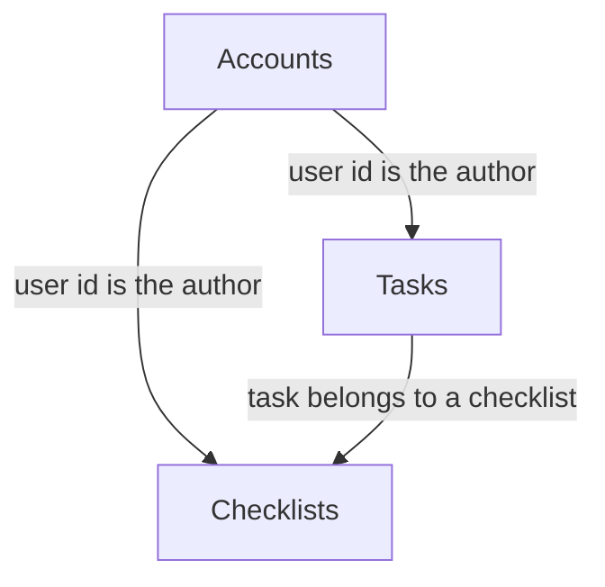

# Knowledge graph — ChecklistsWebApp

Proposal only. Domain names follow the checklist screens.

## Domains

| Domain | Legacy components | Depends on | Complexity | Coupling | Criticality |
|---|---|---|---|---|---|
| Checklists | MVC `ChecklistsController`, API `ChecklistsController`, `Checklist`, checklist views | Accounts for the author. Tasks are children of a checklist | Med | Med | High |
| Tasks | MVC `TasksController`, API `TasksController`, `Task`, task views | Accounts for the author check. Checklists for the parent row | Med | High | High |
| Accounts | `AccountController`, `ManageController`, Identity, OWIN startup | Shared Identity tables in `ApplicationDbContext` | High | Med | Med |

## Shared or ambiguous

- `ApplicationDbContext` holds checklists, tasks, and Identity users. It is not its own domain.
- `IUnitOfWork` is shared plumbing. Ninject is shared plumbing.
- A task cannot be understood without its checklist. Splitting them means the task screen still reads the checklist author.
- Application Insights is diagnostics, not a domain.
