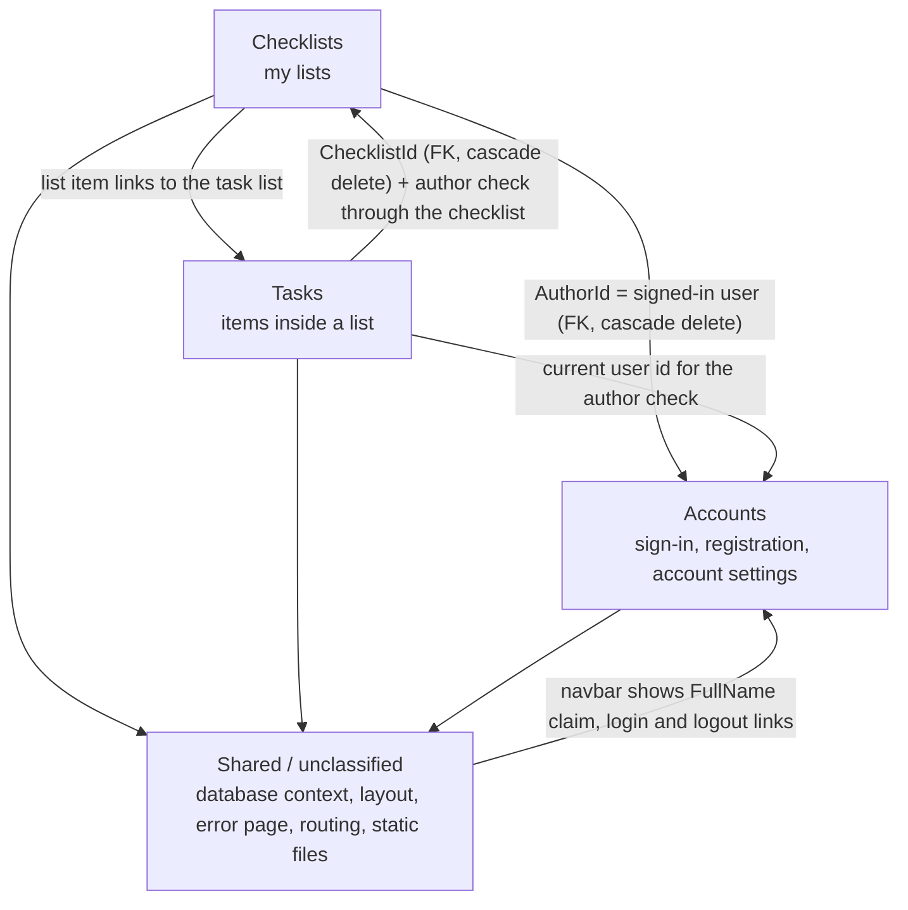

# Knowledge graph — ChecklistsWebApp

Built from `discovery-report.md`. The application is a personal to-do app: a signed-in user keeps named checklists, and each checklist holds tasks that can be checked off.

## Domain diagram

## Domains

| Domain | Legacy components | Depends on | Complexity | Coupling | Business criticality |
|---|---|---|---|---|---|
| **Checklists** | MVC `Controllers/ChecklistsController.cs` (`Index`, `New`, `Save`, `Edit`); API `Controllers/Apis/ChecklistsController.cs` (`Delete`); `Core/Models/Checklist.cs`; `ChecklistRepository`, `IChecklistRepository`; `ChecklistFormViewModel`; `Views/Checklists/Index.cshtml`, `ChecklistForm.cshtml` | Accounts (author), Shared | Low | Medium | High — it is the home page |
| **Tasks** | MVC `Controllers/TasksController.cs` (`Index`, `New`, `Save`, `Edit`); API `Controllers/Apis/TasksController.cs` (`Delete`, `Check`, `Uncheck`); `Core/Models/Task.cs`; `TaskRepository`, `ITaskRepository`; `TaskFormViewModel`, `TaskListingViewModel`; `Views/Tasks/Index.cshtml`, `TaskForm.cshtml` | Checklists (parent row and author), Accounts, Shared | Medium | High | High — the main daily use |
| **Accounts** | `Controllers/AccountController.cs` (14 actions); `Controllers/ManageController.cs` (12 actions); `Core/Models/ApplicationUser.cs`; `App_Start/IdentityConfig.cs`, `Startup.Auth.cs`, `Startup.cs`; `Core/Extensions/IdentityExtensions.cs`; account and manage view models; `Views/Account/*` (12 views + `_ExternalLoginsListPartial`), `Views/Manage/*` (6), `Views/Shared/_LoginPartial.cshtml`, `Views/Shared/Lockout.cshtml` | Shared | High — Identity template with two-factor, phone, external logins, and email flows, most of them wired to empty email and SMS services | Medium — every other domain needs the signed-in user | High — nothing works without sign-in |

## Cross-domain dependencies

| From | To | Kind | Detail |
|---|---|---|---|
| Checklists | Accounts | shared table, FK | `Checklists.AuthorId` → `AspNetUsers.Id`, required, cascade delete. New checklists take the signed-in user id |
| Checklists | Accounts | auth rule | `[Authorize]` on both checklist controllers; `Edit` and API `Delete` compare `AuthorId` to the signed-in user |
| Tasks | Checklists | shared table, FK | `Tasks.ChecklistId` → `Checklists.Id`, cascade delete |
| Tasks | Checklists | direct call | MVC task screens call `ChecklistRepository.GetChecklist` and show the checklist name as the page title |
| Tasks | Checklists → Accounts | auth rule | Task access is allowed only when the parent checklist's `AuthorId` is the signed-in user |
| Checklists | Tasks | UI link | Each checklist name on `/` links to `/checklists/{id}/tasks` |
| Shared | Accounts | UI | `_Layout` renders `_LoginPartial`: `Hello <FullName>!`, Change Password, Log out, or Register and Log in |

## Shared / unclassified components

These are used by more than one domain. They are not assigned to one domain.

| Component | Used by | Risk |
|---|---|---|
| `Persistence/ApplicationDbContext.cs` | all three domains (Identity tables, `Checklists`, `Tasks`) | One context holds every table. A module-only run has to build all of it anyway |
| `Persistence/UnitOfWork.cs`, `Core/IUnitOfWork.cs` | Checklists, Tasks | Exposes both repositories |
| `Views/Shared/_Layout.cshtml`, `Views/_ViewStart.cshtml` | all screens | Navbar brand with logo, footer `© <year> - Checklists`, title `<page> - Checklists` |
| `Views/Shared/Error.cshtml`, `FilterConfig` (`HandleErrorAttribute`) | all MVC screens | |
| `App_Start/RouteConfig.cs`, `WebApiConfig.cs` | all | Default route makes `/` the checklist list |
| `App_Start/BundleConfig.cs`, `Content/`, `Scripts/` | all | Bootstrap 3 + paper theme + `site.css`, jQuery, bootbox |
| `App_Start/NinjectWebCommon.cs` | Checklists, Tasks | Convention binding |
| Application Insights (`ApplicationInsights.config`, HTTP module) | all | No instrumentation key; decision needed |

## Notes for scope selection

- Tasks cannot be modernized without the Checklists table and its author rule. Checklists cannot run without sign-in.
- Accounts is the biggest domain by action count (26 of 38 actions), but most of its flows depend on email, SMS, or external providers that the legacy app never configured.
- Red flags from discovery that cross domains: the MVC `TasksController` has no `[Authorize]`, and `Tasks.Save` and `Checklists.Save` do not check ownership.
