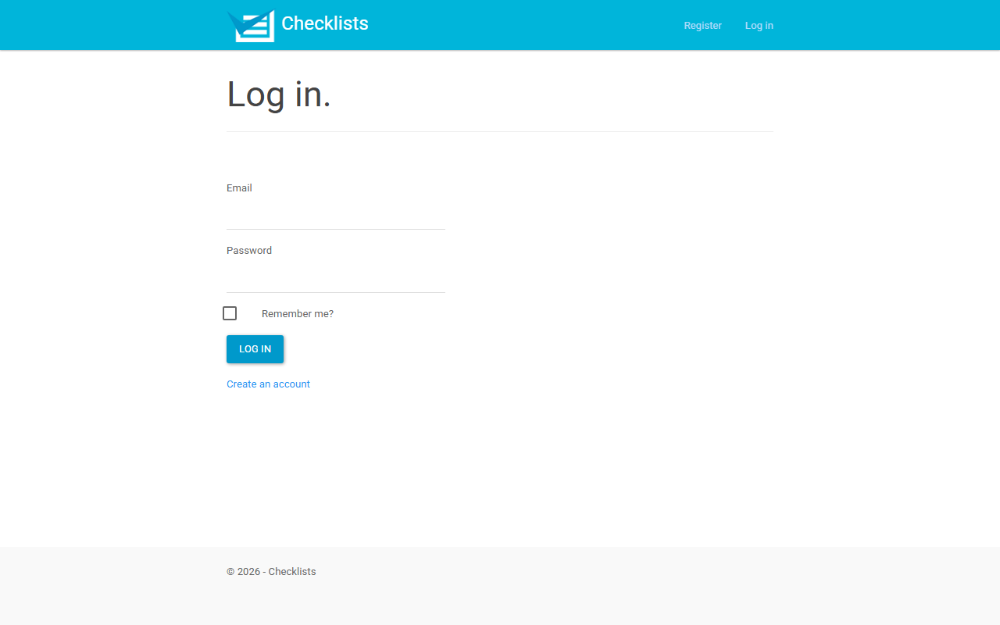
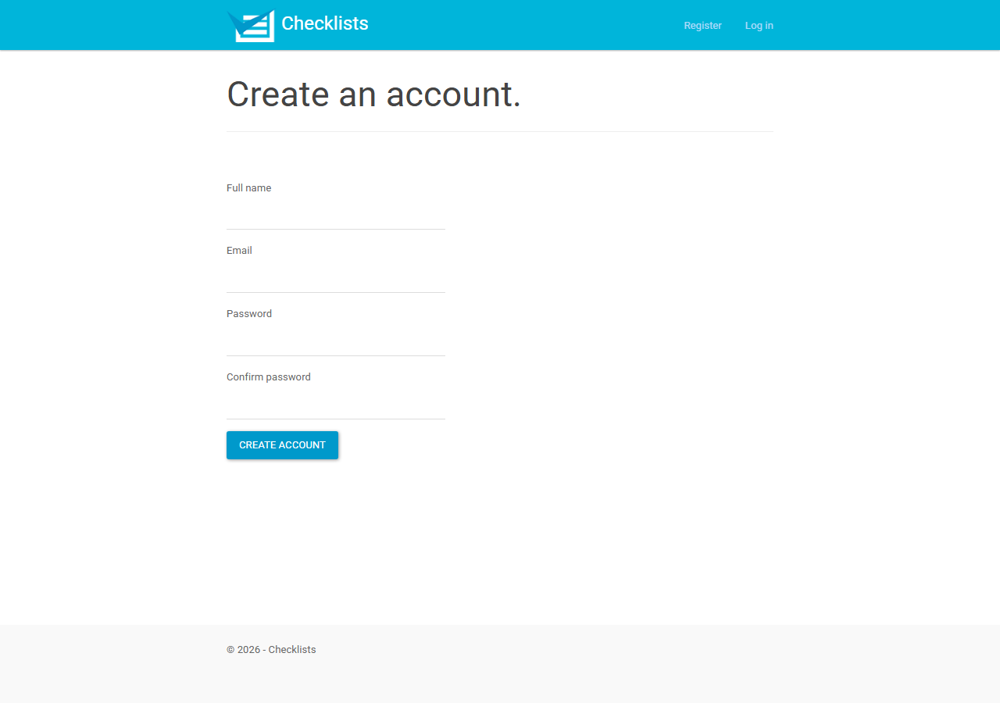

# Phase 7 walkthrough: ChecklistsWebApp on .NET 10

Scope: whole application
Classification: finished modernization (real persistence, not a prototype)
Data source: `ConnectionStrings:DefaultConnection` = `Data Source=checklists.db` (SQLite file, Development settings), created and seeded at startup with the preview rows from `plan.md`

## Run the preview

```powershell
cd runs\ChecklistsWebApp\modernized\ChecklistsModern
Remove-Item checklists.db* -ErrorAction SilentlyContinue   # start from the seeded rows
$env:ASPNETCORE_ENVIRONMENT = "Development"
dotnet run --urls http://localhost:5181
```

Open http://localhost:5181 and sign in through the login page.

| User | Password | What it shows |
|---|---|---|
| `author@checklists.local` (Alex Author) | `Preview123!` | Owns "Packing list" with Passport, Charger (checked) and a deleted task; owns the deleted "Old list" |
| `other@checklists.local` | `Preview123!` | Owns "Other list"; use it to see that other users are blocked |
| `empty@checklists.local` | `Preview123!` | No checklists (empty states) |
| `twofactor@checklists.local` | `Preview123!` | Two-factor on, so login goes to Send Code |

The preview password exists only in `PreviewSeeder` and the Development settings. It is not the legacy publish profile password, which was not copied.

## How the walkthrough was run

The app was started as above on a fresh database. Every flow was driven over HTTP against the running app, signing in through the real `/Account/Login` form with the antiforgery token from the page, the same way a browser does. The order was: shared foundation, Accounts, Manage, Checklists, Tasks, then cross-domain. Result: 65 of 65 checks shown, 34 of 34 stories. The raw log is `walkthrough-run.log`.

The script first reported 4 checks as not shown. All four were errors in the walkthrough script, not in the app:

- Three were login redirects. Identity sends an absolute URL (`http://localhost:5181/Account/Login?ReturnUrl=...`) and the script expected a relative path.
- One was Forgot password. It renders the confirmation view directly, as legacy does, instead of redirecting.

The xUnit tests already checked both behaviors correctly. The script was fixed and rerun.

Screenshots from headless Edge show the legacy Paper theme, logo, navbar and footer:





## Story to what was demonstrated

### Shared foundation

| Story | Demonstrated | Result |
|---|---|---|
| US-SF-01 Layout and navigation bar | Anonymous navbar shows brand, Register and Log in; footer shown; Signed-in navbar shows Hello Alex Author!, Change Password, Log out; bootstrap.css, bootstrap-paper.css and Site.css load (200) | Shown |
| US-SF-02 Default route | / shows My Checklists; /Home returns 404 | Shown |
| US-SF-03 Error page | Error view shows "An error occurred while processing your request." inside the layout | Shown |

### Accounts: sign-in and registration

| Story | Demonstrated | Result |
|---|---|---|
| US-AC-01 Log in | Login form shows Email, Password, Remember me?; Correct login with ReturnUrl=/Manage redirects to /Manage; Correct login with no return URL redirects to /Home (legacy); Wrong password shows Invalid login attempt.; Two-factor user is sent to /Account/SendCode | Shown |
| US-AC-02 Register | Valid registration redirects to / and the navbar shows Hello Walker Preview!; Duplicate email shows "is already taken." | Shown |
| US-AC-03 Log out | Log out (POST) redirects to / and / then sends to login; GET /Account/LogOff returns 404 | Shown |
| US-AC-04 Forgot password | Unknown email shows the Forgot Password Confirmation page | Shown |
| US-AC-05 Reset password | ResetPassword without code shows the error page; ResetPassword with a code shows the reset form; Reset for unknown email goes to ResetPasswordConfirmation | Shown |
| US-AC-06 Confirm email | ConfirmEmail with a bad code shows the error page | Shown |
| US-AC-07 Two-factor sign-in | SendCode after the password step lists Email Code; Choosing Email Code goes to VerifyCode; Wrong code shows Invalid code. | Shown |
| US-AC-08 External logins | ExternalLoginFailure shows Unsuccessful login with service.; ExternalLoginCallback with no external sign-in redirects to /Account/Login | Shown |

### Accounts: account settings (Manage)

| Story | Demonstrated | Result |
|---|---|---|
| US-MG-01 Account settings page | Manage shows Password, External Logins, Two-Factor sections and the status message; Anonymous /Manage redirects to login | Shown |
| US-MG-02 Change password | Wrong current password shows Incorrect password. | Shown |
| US-MG-03 Set password | Set password for a user who has one shows User already has a password set. | Shown |
| US-MG-04 Manage external logins | ManageLogins says no external services are configured | Shown |
| US-MG-05 Phone number | Valid number redirects to VerifyPhoneNumber; Wrong code shows Failed to verify phone | Shown |
| US-MG-06 Turn two-factor on and off | Enable two-factor redirects to /Manage; Disable two-factor redirects to /Manage | Shown |

### Checklists

| Story | Demonstrated | Result |
|---|---|---|
| US-CL-01 See my checklists | Author sees Packing list, not Old list (deleted) or Other list (other user); Each checklist has Edit and Delete controls; Empty user sees You don't have any checklists. | Shown |
| US-CL-02 Create a checklist | Saving "Walkthrough list" redirects to / and the list shows it; Empty name shows The Name field is required. | Shown |
| US-CL-03 Rename a checklist | Edit form shows the current name; Another user opening Edit is sent to login; Rename saves and the list shows Walkthrough renamed | Shown |
| US-CL-04 Delete a checklist | Another user deleting gets 401; Author delete returns 204 and the list no longer shows it | Shown |
| US-CL-05 Delete confirmation on the list | List page has the confirm text and the api/checklists/ script | Shown |

### Tasks

| Story | Demonstrated | Result |
|---|---|---|
| US-TK-01 See the tasks in a checklist | Task page shows Packing list heading, Add Task, Passport and Charger, not Old task; Charger checkbox is checked; Another user is sent to login | Shown |
| US-TK-02 Add a task | New Task form shows Title, hidden ChecklistId 1, Save, Cancel; Title input has no maxlength (legacy behavior); Saving Sunscreen redirects to /checklists/1/tasks and the list shows it | Shown |
| US-TK-03 Rename a task | Edit form for Passport shows Modify Task and value Passport; Edit of Passport under checklist 3 is 404 | Shown |
| US-TK-04 Task save has no owner check | Another user can add a task to checklist 1 through Save (legacy gap) | Shown |
| US-TK-05 Delete a task | Another user deleting a task gets 401; Author delete returns 204 and Sunscreen leaves the list | Shown |
| US-TK-06 Check a task | Checking Passport returns 200 and the box is checked on reload; Checking the deleted task returns 400 {"Message":"Cannot check a deleted item"} | Shown |
| US-TK-07 Uncheck a task | Unchecking Passport returns 204 and the box is clear on reload; Another user unchecking gets 401 | Shown |

### Cross-domain

| Story | Demonstrated | Result |
|---|---|---|
| US-XD-01 A new account owns the checklists it creates (Accounts → Checklists) | Nina registers, creates Nina's list and sees it; the author does not | Shown |
| US-XD-02 Tasks belong to a checklist (Checklists → Tasks) | Following the list link opens its task page with the heading and the new task | Shown |
| US-XD-03 A deleted checklist keeps its task page reachable (Checklists → Tasks) | After deleting Nina's list it leaves / but its task page still opens | Shown |
| US-XD-04 Task access follows the checklist author (Tasks → Checklists → Accounts) | The author checking Nina's task gets 401; Nina gets 200 | Shown |
| US-XD-05 The layout shows the signed-in account (Shared → Accounts) | After changing the password the navbar still shows Hello Nina New! | Shown |

