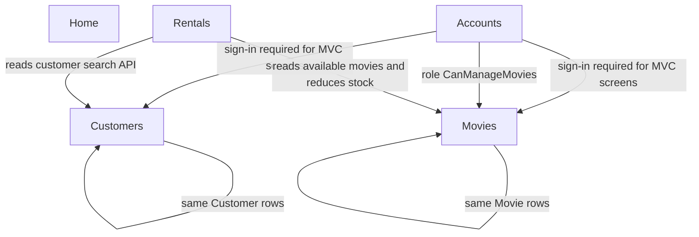

# Knowledge graph — vidly-mvc-5

Proposal only. Domain names follow the video-store screens, not the project layers.

The last two lines mean each of Customers and Movies is stored once and used by both its MVC pages and its API.

## Domains

| Domain | Legacy components | Depends on | Complexity | Coupling | Criticality |
|---|---|---|---|---|---|
| Customers | `CustomersController`, `Api/CustomersController`, `Customer`, `MembershipType`, `CustomerDto`, `MembershipTypeDto`, `CustomerFormViewModel`, `Min18YearsIfAMember`, views `Customers/*` | Accounts for the MVC pages. Membership types are seed data inside this domain | Med | Med | High — menu item, and rentals search customers |
| Movies | `MoviesController`, `Api/MoviesController`, `Movie`, `Genre`, `MovieDto`, `GenreDto`, `MovieFormViewModel`, views `Movies/*` including `Random` | Accounts for sign-in. Role `CanManageMovies` for add, edit, save, and API create/update/delete | Med | Med | High — menu item, and rentals search movies |
| Rentals | `RentalsController.New`, `Api/NewRentalsController`, `Rental`, `NewRentalDto`, view `Rentals/New` | Customers and Movies. The screen does not save through the MVC controller | Med | High | High — menu item "New Rental", and it changes movie stock |
| Accounts | `AccountController`, `ManageController`, `ApplicationUser`, Identity config, OWIN startup, views `Account/*` and `Manage/*` | Shared Identity tables. Seed role `CanManageMovies` is used by Movies | High | Med | Med — template Identity, plus driving license and phone |
| Home | `HomeController`, views `Home/*` | None. Anonymous | Low | Low | Low — template pages |

## How they connect

- A signed-in user is required for customer, movie, and rental MVC pages because `Authorize` is global. Home and the login/register actions are anonymous.
- The rental form calls `/api/customers` and `/api/movies`, then posts `/api/newRentals`. That post writes a `Rental` and decrements `Movie.NumberAvailable`.
- Customer list and movie list pages also call those same APIs. The form pages talk to the database through the MVC controllers.
- One role matters outside Accounts: `CanManageMovies`. It changes the movie list and blocks movie create, edit, and delete.

## Shared or ambiguous

- `ApplicationDbContext` holds customers, movies, rentals, and Identity users in one database. It is not its own business domain.
- `Customer` and `Movie` are shared data. Rentals reads and updates them. Putting rentals in the same module as movies would hide that stock rule. Leaving them separate means a Customers-only or Movies-only slice still has to serve the rental screen's API, or the rental screen breaks.
- AutoMapper profiles, the layout, the navbar, and the CSS bundle are shared chrome. They are not a domain.
- Glimpse and Elmah are diagnostics, not a domain.
- `Movies/Random` is a demo page inside Movies. It does not use the movie table.
